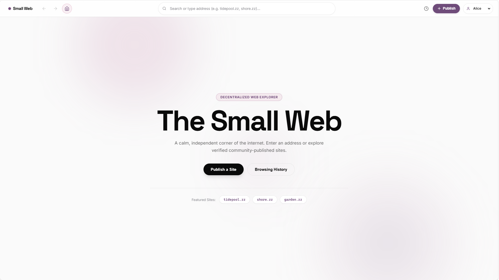
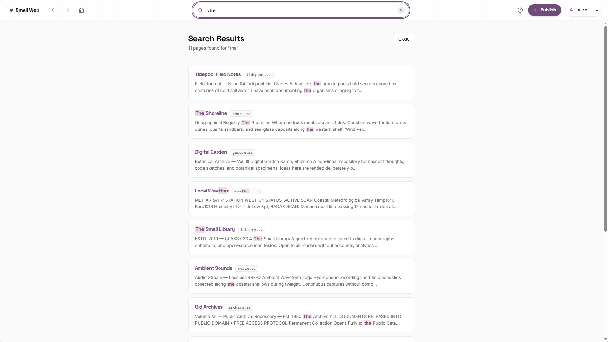
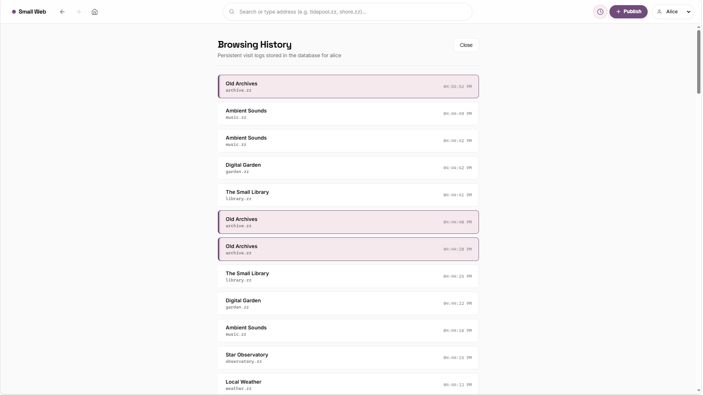
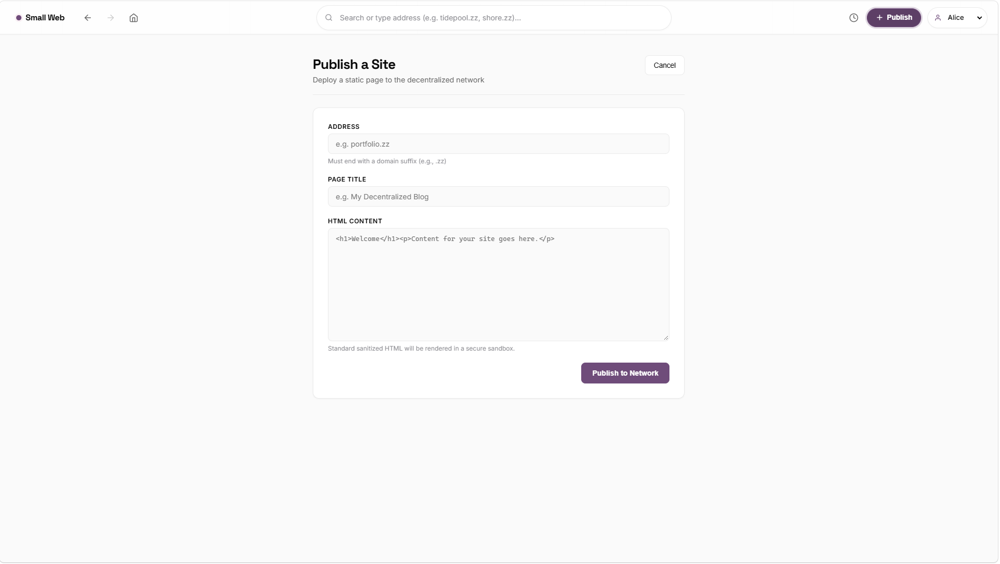
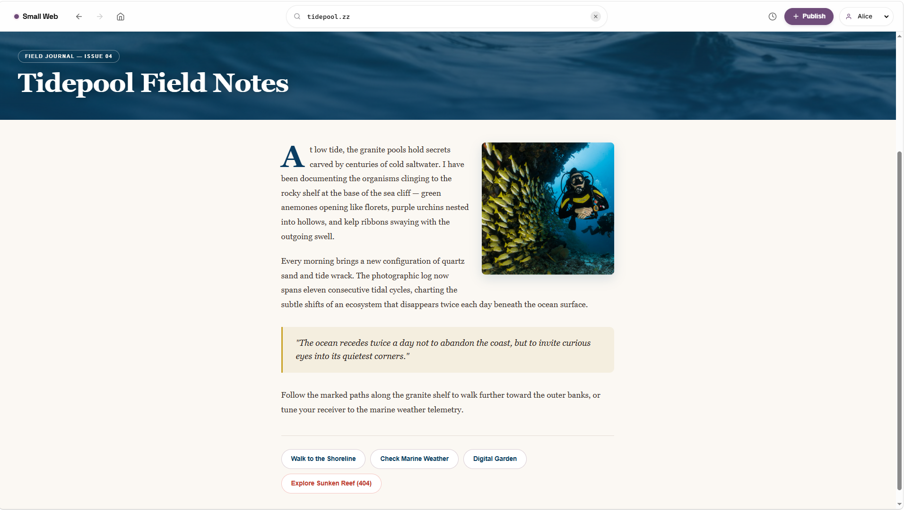
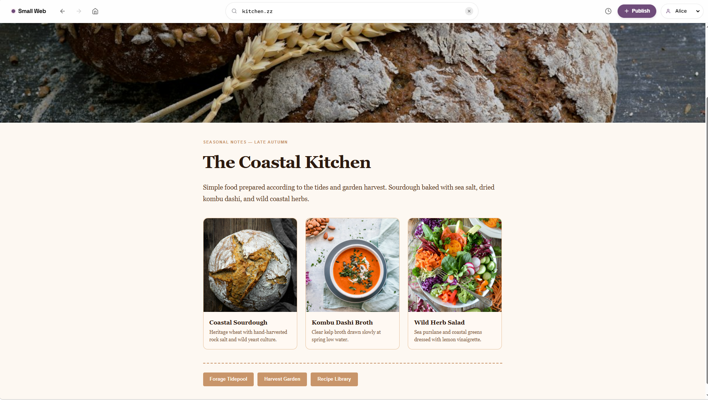

# Small Web Browser

A calm, independent web client simulation designed to explore and publish decentralized personal websites. It provides an authentic browser-within-a-browser experience with multi-persona history tracking, deterministic navigation stacks, and secure sandboxed rendering.

## Tech Stack

- **Frontend:** Next.js (App Router, React 19)
- **Backend:** NestJS 12
- **Database:** MongoDB (via Mongoose)
- **Language:** TypeScript
- **Monorepo:** pnpm workspaces

## Prerequisites

- **Node.js:** v20+
- **pnpm:** v9.15.0 (pinned via `packageManager` in `package.json`)
- **MongoDB:** Running locally at `mongodb://localhost:27017/small-web`

> **First time?** Start MongoDB with Docker in one line:
> ```bash
> docker compose up -d
> ```
> (Or: `docker run -d -p 27017:27017 --name small-web-mongo mongo:7`)

## How to Run

1. **Install dependencies:**
   ```bash
   pnpm install
   ```

2. **Start MongoDB:**
   ```bash
   docker compose up -d
   ```

3. **Seed the database:**
   ```bash
   pnpm --filter api seed
   ```

4. **Start the Backend API (port 3001):**
   ```bash
   pnpm --filter api start:dev
   ```

5. **Start the Frontend Web Client (port 3000):**
   ```bash
   pnpm --filter web dev
   ```

## Testing

Run unit tests for the shared navigation stack:

```bash
pnpm --filter @small-web/shared test
```

## Known Issues & Quick Fixes

| Error | Cause | Fix |
|-------|-------|-----|
| `ERR_PNPM_MINIMUM_RELEASE_AGE_VIOLATION` | pnpm v11+ blocks packages published in the last 24h | Already disabled via `minimumReleaseAge: 0` in `pnpm-workspace.yaml` |
| `ERR_PNPM_IGNORED_BUILDS` (esbuild, @parcel/watcher) | pnpm v11+ blocks postinstall scripts | Already pre-approved via `onlyBuiltDependencies` in `pnpm-workspace.yaml` |
| `MongoServerSelectionError: ECONNREFUSED 127.0.0.1:27017` | MongoDB is not running | Run `docker compose up -d` before seeding |
| `pnpm` version mismatch | Using a version other than 9.15.0 | Run `corepack enable` once, then `pnpm install` will auto-pin |

## Screenshots

### The Browser Shell & Home Page



### Search & Highlighting



### Per-Persona History



### Publish Form



### Seeded 1-Page Websites







## Architecture & Design Decisions

- **Custom `NavigationStack`:** Implements a formal history invariant where branching from an earlier state truncates forward history, decoupled from host browser routing.
- **Two-Layer XSS Defense:** Strict server-side HTML sanitization (stripping executable tags, inline styles, and invalid image sources) paired with an unprivileged, sandboxed `<iframe>` boundary without `allow-same-origin`.
- **Dual-Query Search Pipeline:** Combines MongoDB `$text` inverted index scoring with case-insensitive regex fallback across addresses, titles, and body content, deduplicated via an $O(1)$ hash map.
- **Deterministic & Idempotent Seeding:** The seed pipeline drops and rebuilds database collections and indexes cleanly on every run, guaranteeing identical initial state across runs.
